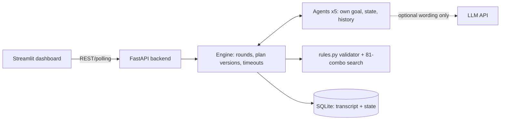

# ARES ACCORD - multi-agent Mars colony negotiation

Five agents (Commander, Life Support, Medical, Food, Engineering) negotiate a shared resource pool.
The Commander can only approve a plan when a **deterministic validator** passes and **all four agents ACCEPT the same plan version**.

## Architecture

- `backend/app/rules.py` fixed mode packages, validator, search, INFEASIBLE analysis (no model involved)
- `backend/app/agents.py` independent agents; `engine.py` message bus + negotiation loop; `store.py` persistence
- `backend/app/llm.py` optional rephrasing. Falls back to rule text, labelled `rule-fallback`; numbers and decisions never come from it

## Run
```
pip install -r backend/requirements.txt -r frontend/requirements.txt
cd backend && uvicorn app.main:app --port 8000     # terminal 1
cd frontend && streamlit run streamlit_app.py       # terminal 2  -> http://localhost:8501
```
Or `run.bat` / `run.sh`, or `docker compose up --build`. API docs: http://localhost:8000/docs.
**Reset:** sidebar "Reset everything" (or `POST /api/reset`, or delete `ares.db`).

## API
`GET /api/state` · `GET /api/transcript?since=` · `GET /api/modes` · `POST /api/start {pool,policy}` · `POST /api/event {name,delta[5],allow_override}` · `POST /api/reset` · `GET /api/export/json|csv`

## Test
`cd backend && python -m pytest -q tests` (baseline approval, refusal, 2 commitments, 4 votes, stale-vote blocking, event renegotiation, INFEASIBLE).
Manual: Start crisis → 4 rounds, v2 approved → inject event (any deltas) → STALE → new approval, or INFEASIBLE with the blocking constraint.

## Known limitations
Agent decisions are rule-based; the optional LLM only rewords messages. State is single-process (one active scenario). Never commit `.env`.
